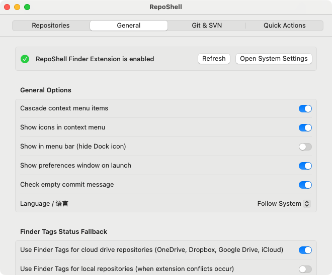
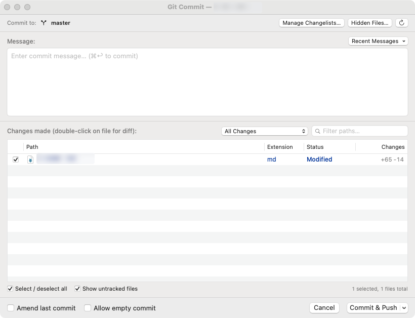
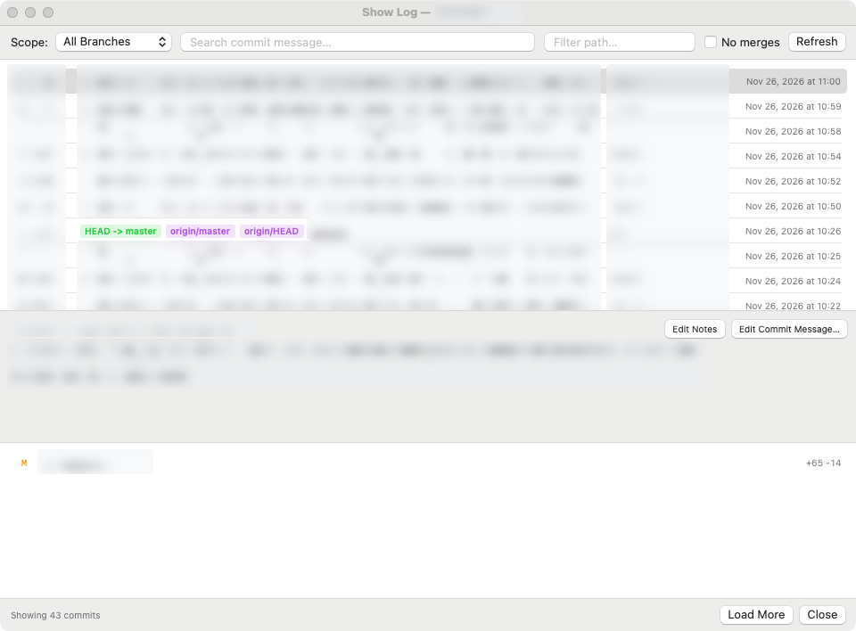

# RepoShell

**RepoShell** 是一款面向 macOS（13.0 Ventura+，Universal `arm64` / `x86_64`）的原生版本控制图形客户端与 Finder 深度集成工具，提供经典的 **TortoiseGit / TortoiseSVN** 风格交互体验。

- **开发者**：leaf (`flying_butterfly@126.com`)
- **当前版本**：`0.1.3`
- **GitHub 仓库**：`https://github.com/backkom/repo-shell`
- **开源协议**：[MIT License](LICENSE)

---

## 核心特性

- **Finder 深度集成**：通过 `RepoShellFinderSync` 扩展在 Finder 中实时展示文件/文件夹状态角标，提供右键上下文菜单与工具栏菜单，支持 Finder 标签（Tags）着色与 Quick Actions（`.workflow`）快速操作。
- **Git 完整支持**：涵盖日常操作（Clone、Commit、Pull/Push/Fetch、Branch/Tag、Stash、Revert、Resolve Conflicts）与进阶工作流（交互式 Rebase、Cherry-Pick、RefLog、Repo-browser、版本对比、Blame、Submodules、Changelists、隐藏文件规则、Commit Notes）。
- **SVN 支持**：基于统一的 `VcsProvider` 抽象层提供 SVN 工作副本管理与常用版本控制窗口。
- **Diff / Merge 与内置图片对比**：支持 20+ 主流外部 Diff/Merge 工具自动探测与调用、`Diff later` 对比，以及内置并排/叠加/分屏/差值图片对比窗口。
- **认证与自包含 Git**：支持按仓库配置 HTTPS / SSH 认证与 macOS Keychain 存储，内置 `git-credential-reposhell` 与 `reposhell-askpass`；应用内嵌便携版 Git（亦可在设置中切换自定义外部 `git` / `svn` 路径）。
- **应用内更新**：支持自动或手动检查 GitHub Releases 新版本并一键下载升级，提供中英文双语界面。

详细架构与设计说明请参阅 [docs/DESIGN.md](docs/DESIGN.md)。

---

## 界面预览

### 偏好设置与 Finder 扩展状态


### Git 提交（Commit）


### 提交日志（Show Log）


---

## 安装与首次打开说明

1. 前往 [GitHub Releases](https://github.com/backkom/repo-shell/releases) 下载最新版本的 `RepoShell-<version>-macOS.dmg` 或 `RepoShell-<version>-macOS.zip`。
2. 将 `RepoShell.app` 拖入 `/Applications`（应用程序）目录。

### 解决 macOS 无法打开 /「已损坏」提示

由于仓库默认构建的发布包暂未经过 Apple 公证（或使用 ad-hoc 签名），首次打开时 macOS Gatekeeper 可能会提示：**「无法验证开发者」** 或 **「"RepoShell.app" 已损坏，无法打开。你应该将它移到废纸篓。」**

请在「终端」执行以下命令清除隔离属性（Quarantine）后再打开：

```bash
xattr -cr /Applications/RepoShell.app
```

> 如果你的应用放在其他目录，请将命令中的 `/Applications/RepoShell.app` 替换为实际路径（也可以先输入 `xattr -cr ` 再把 `RepoShell.app` 拖进终端窗口自动补全路径）。

### 启用 Finder 扩展

首次运行后，前往 **系统设置 → 扩展 → 添加的扩展 / 访达扩展**（macOS 新版路径为 **系统设置 → 通用 → 登录项与扩展 → 访达扩展**），勾选启用 **RepoShellFinderSync**，并在 RepoShell 主窗口添加工作副本或工作区父目录即可看到状态角标与右键菜单。

---

## 目录结构

```text
repo-shell/
├── .github/workflows/release.yml   # GitHub Actions 自动编译与 Release 发布流程
├── docs/DESIGN.md                  # 架构与工程设计文档
├── Packages/RepoShellCore/         # 核心 Swift Package（RepoShellShared / RepoShellVcs / RepoShellServices）
├── Targets/
│   ├── RepoShellApp/               # macOS 主应用（AppKit + SwiftUI 多窗口界面）
│   ├── RepoShellFinderSync/        # Finder Sync 扩展（状态角标 + 右键/工具栏上下文菜单）
│   └── Helpers/                    # git-credential-reposhell 与 reposhell-askpass 辅助程序
├── Resources/                      # 本地化文案（en / zh-Hans）、脚本与图标资源
└── scripts/                        # Xcode 工程生成、内置 Git 打包与便携 Git 编译脚本
```

---

## 本地构建与测试

```bash
# 1. 运行核心包单元测试与集成测试
cd Packages/RepoShellCore && swift test

# 2. 生成 RepoShell.xcodeproj
python3 scripts/generate_xcodeproj.py

# 3. 编译并签名 RepoShell.app
xcodebuild -project RepoShell.xcodeproj -scheme RepoShell -configuration Debug -derivedDataPath build/DerivedData build
```

> **签名提示**：macOS 要求 Finder Sync 扩展必须签名且启用 App Sandbox，本地构建默认使用本机可用的 `Apple Development` 证书。若无证书用于本地调试，可在 `xcodebuild` 时追加 `CODE_SIGN_IDENTITY="-" CODE_SIGN_STYLE="Manual" DEVELOPMENT_TEAM=""` 使用 ad-hoc 签名。

---

## GitHub Actions 自动编译与发版

项目在 [.github/workflows/release.yml](.github/workflows/release.yml) 中配置了自动编译与发布流程：

- 推送到 `main` / `master` 分支、提 PR 或手动触发 `workflow_dispatch` 时，会自动运行测试、编译 Universal（`arm64 + x86_64`）应用并上传构建产物（Artifact）。
- 推送以小写 `v` 开头的 tag（如 `v0.1.0`）到 GitHub 仓库时，会自动创建对应版本号的 GitHub Release，并上传 `RepoShell-<version>-macOS.zip`、`RepoShell-<version>-macOS.dmg` 与 `SHA256SUMS.txt`。
- 如需在 CI 中使用正式签名证书，可在 GitHub 仓库 `Settings → Secrets and variables → Actions` 配置 `MACOS_CERTIFICATE_P12`、`MACOS_CERTIFICATE_PASSWORD`、`APPLE_TEAM_ID` 和可选的 `APPLE_SIGN_IDENTITY`；未配置时会自动回退到 ad-hoc 签名。
