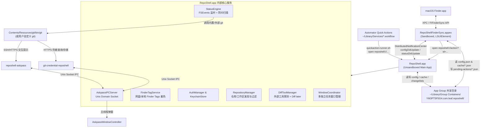
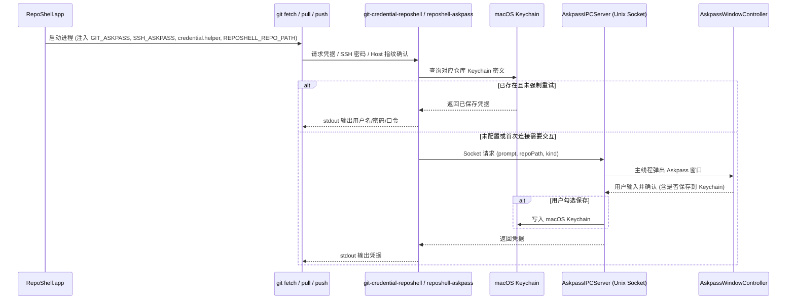

# RepoShell 详尽架构与工程设计文档

> **版本**：V1.0（Git 完整版 + V2 SVN 架构预留）  
> **目标平台**：macOS 13.0 (Ventura) 及以上（Apple Silicon / Universal）  

---

## 第 1 章：项目概述与已确认设计决策

### 1.1 项目愿景
**RepoShell** 是面向 macOS 的原生版本控制图形客户端与 Finder 深度集成工具，提供经典的 **Tortoise 风格**交互体验：日常轻量驻留（Dock 或系统菜单栏模式可切换），直接在 Finder 文件图标上叠加仓库文件状态角标，并通过 Finder 右键上下文菜单与 Finder 工具栏按钮快速唤出独立的任务窗口（Commit、Log、Modifications、Pull/Push/Fetch、Rebase、Cherry-Pick、Repo-browser 等）。

### 1.2 已确认核心设计决策清单

| 编号 | 决策领域 | 已确认方案 | 核心约束与工程影响 |
| :--- | :--- | :--- | :--- |
| **1** | 产品形态 | **单 App 统一形态（1-A）** | 单一 `RepoShell.app` + 单一 `RepoShellFinderSync.appex`，通过根目录 `.git`/`.svn` 自动识别仓库类型；V1 实现 Git 后端，通过 `VcsProvider` 协议抽象为 V2 SVN 无缝扩展打底。 |
| **2** | 桌面形态 | **经典 Tortoise 风格（2-A）** | 无重型统一工作台主窗；主窗口负责「仓库与工作区管理 + 偏好设置」，所有版本控制操作均以独立轻量窗口承载；支持隐藏 Dock 仅驻留菜单栏。 |
| **3** | 沙盒与分发 | **非沙盒主 App + 沙盒 Finder 扩展（3-A）** | 主 App 关闭 App Sandbox（非沙盒直发/自用，免繁琐路径授权弹窗，可直接读写 `~/.gitconfig`、`~/.ssh`、唤起任意外部 Diff/Merge 工具）；**`FinderSync.appex` 按 macOS 系统硬性要求启用 `app-sandbox = true`**。 |
| **4** | 技术栈 | **纯 Swift 原生（4-A）** | AppKit (`NSWindowController`、`NSStatusItem`、`FIFinderSync`) + SwiftUI（macOS 13 兼容 API）混合；零跨语言 FFI；核心逻辑封装在 `Packages/RepoShellCore` 中。 |
| **5** | Git 引擎 | **自包含便携 Git + 外部切换（5-C）** | Bundle 内 `Contents/Resources/git/` 打包独立 relocatable `git`；支持首选项切换外部自定义 `git` 路径；提供发版编译脚本 `scripts/build-portable-git.sh`（13.0+ Universal）与本地打包脚本 `scripts/bundle-git.sh`。 |
| **6** | 系统兼容 | **macOS 13.0 (Ventura)+（6-C）** | 全工程 `MACOSX_DEPLOYMENT_TARGET = 13.0`；严格禁止 `@Observable`、`ContentUnavailableView`、双参 `onChange` 等 macOS 14+ 独占 API。 |
| **7** | Finder 集成 | **无限仓库 + 父目录自动发现 + 网盘兜底（7.1-A, 7.2-B）** | 支持不限数量的显式添加仓库、添加工作区父目录自动递归扫描、排除列表；V1 完整提供 **Finder 标签（Tags）状态着色**（网盘/本地独立开关）与 **Quick Actions（`.workflow`）安装管理**。 |
| **8** | Diff / Merge | **外部工具生态 + 内置图片对比（8-A）** | 完整支持 20+ 主流外部 Diff 工具与 10+ 外部 Merge 工具自动探测与变量模板调用；支持 `Diff later` / `Diff with "..."`；图片文件内置 `ImageDiffWindowController`（并排/叠加/分屏/差值）。 |
| **9** | 身份验证 | **每仓库认证管理 + Keychain + Askpass（9-B）** | 支持按仓库配置认证方式（无 / 用户名密码 / SSH 私钥+端口+口令）；macOS Keychain 存储；内置 `git-credential-reposhell` 与 `reposhell-askpass` 经本地 Unix Socket 触发主 App 弹窗。 |
| **10** | V1 功能范围 | **全量基础 + 进阶 Git 功能（含中英双语）** | 包含全部日常操作窗口与进阶窗口（Rebase、Cherry-Pick、RefLog、Repo-browser、Compare Revisions、Blame、Submodules、Changelists、Hidden Files、Commit Notes）；不含 LFS、全局快捷键、操作快速搜索框、独立 CLI。 |
| **11** | 命名、签名与 V2 | **`RepoShell` + Apple Development 签名 + V2 SVN 设计（10, 11-A）** | Bundle ID `com.leaf.reposhell`；macOS 要求 FinderSync 扩展必须签名方可加载，因此统一使用 `Apple Development`（Team `YM3PT5F5G4`）签名；单设第 10 章完整规划 V2 SVN。 |

### 1.3 为何采用「非沙盒主 App + 沙盒 FinderSync + Apple Development 签名」

1. **为什么 FinderSync 必须签名**：macOS `pkd` / `pluginkit` 守护进程会拦截未签名或 Ad-hoc 签名在重启/跨进程挂载时的 App Extension，常将插件标记为 `F`（Failed）或无法在系统设置中持久启用；使用有效 `Apple Development`（或发版时的 `Developer ID Application`）签名可确保 `RepoShellFinderSync.appex` 被系统稳定注册。
2. **为什么是混合沙盒架构**：macOS 要求所有 `com.apple.FinderSync` 扩展必须开启 `com.apple.security.app-sandbox = true`；但主 App 若不走 Mac App Store，关闭 Sandbox 即可彻底摆脱 Security-Scoped Bookmarks 对用户工作区、`.git/config`、`~/.ssh` 及外部 Diff 工具的权限封锁。两者使用以 Team ID 为前缀的 App Group 标识符 `YM3PT5F5G4.com.leaf.reposhell`：
   - **FinderSync Extension（沙盒内）**调用 `FileManager.default.containerURL(forSecurityApplicationGroupIdentifier: "YM3PT5F5G4.com.leaf.reposhell")` 读写共享数据；
   - **主 App 与 Helpers（非沙盒）**直接读写物理路径 `~/Library/Group Containers/YM3PT5F5G4.com.leaf.reposhell/`；
   - 两者在磁盘上映射到**完全一致的目录**，且非沙盒主 App **不需要**额外的 Provisioning Profile 即可与同 Team 签名的 Extension 协同工作。

---

## 第 2 章：总体架构与模块划分

### 2.1 运行时进程拓扑



### 2.2 代码目录与 Swift 模块依赖结构

```text
repo-shell/
├── docs/
│   └── DESIGN.md                         # 本文档
├── Packages/
│   └── RepoShellCore/
│       ├── Package.swift                 # macOS 13.0+, Swift 5.9
│       ├── Sources/
│       │   ├── RepoShellShared/          # 纯共享模型、常量、IPC 存储、菜单规则引擎、本地化
│       │   ├── RepoShellVcs/             # VCS 抽象协议、ProcessRunner、GitProvider、Parsers、SVN Stub
│       │   └── RepoShellServices/        # FSEvents 状态引擎、仓库管理、FinderTags、QuickActions、Auth/IPC、DiffTool
│       └── Tests/
│           └── RepoShellCoreTests/       # 解析器单测、菜单/聚合规则测试、真实 Git 仓库集成测试
├── Targets/
│   ├── RepoShellApp/                     # 主应用 UI (AppKit 窗口控制器 + SwiftUI 内容视图)
│   ├── RepoShellFinderSync/              # FinderSync Extension (.appex)
│   └── Helpers/
│       ├── GitCredentialHelper/          # git-credential-reposhell
│       └── AskpassHelper/                # reposhell-askpass
├── Resources/
│   ├── en.lproj/Localizable.strings
│   ├── zh-Hans.lproj/Localizable.strings
│   ├── Assets/                           # AppIcon, MenuBarIcon
│   └── Scripts/                          # quickaction-runner.sh, git-sequence-editor.sh, git-message-editor.sh
└── scripts/
    ├── generate_xcodeproj.py             # 生成 RepoShell.xcodeproj
    ├── bundle-git.sh                     # Xcode Build Phase 打包内置 git
    └── build-portable-git.sh             # 从源码构建 Ventura 13.0+ Universal 便携 git
```

模块依赖严格保持单向无环：
- `RepoShellFinderSync` **仅依赖** `RepoShellShared`（保持内存足迹极小、零重型依赖、禁止在 Extension 中拉起 git 子进程）。
- `GitCredentialHelper` & `AskpassHelper` **仅依赖** `RepoShellShared`（及 Security/POSIX Socket）。
- `RepoShellVcs` 依赖 `RepoShellShared`。
- `RepoShellServices` 依赖 `RepoShellShared` + `RepoShellVcs`。
- `RepoShellApp` 依赖全部三个 Core 模块。

---

## 第 3 章：跨进程通信（IPC）与状态缓存协议

### 3.1 App Group 共享目录布局
物理根路径：`~/Library/Group Containers/YM3PT5F5G4.com.leaf.reposhell/`

```text
YM3PT5F5G4.com.leaf.reposhell/
├── config.json                 # 全局偏好、仓库列表、工作区扫描父目录、排除路径、每仓库认证配置
├── diff-later.json             # 当前暂存的 "Diff later" 基准文件路径与 VCS 类型
├── askpass.sock                # AskpassIPCServer 监听的 Unix Domain Socket
├── cache/
│   └── <sha256_prefix16>.json  # 按仓库根路径哈希索引的 RepoStatusSnapshot（文件状态映射+分支+仓库态）
├── pending-actions/
│   └── <uuid>.json             # FinderSync 写入的大型路径列表载荷（避免 URL 参数过长被截断）
├── changelists/
│   └── <sha256_prefix16>.json  # 每仓库 Changelists（名称 + 文件相对路径集合）
├── hidden-files/
│   └── <sha256_prefix16>.json  # Commit 窗口隐藏文件规则（精确路径 / 通配符）
└── history.json                # 最近提交信息、最近克隆/远程 URL
```

所有 JSON 文件均通过 `SharedStorage` 采用 **同目录临时文件 + `FileManager.replaceItemAt`（或 `rename(2)`）原子写入**，防止 FinderSync 与主 App 并发读写时出现半截 JSON 解析失败。

### 3.2 `config.json` 与 `cache/<hash>.json` 数据契约

#### `SharedConfig` (`config.json`)
- `repositories: [RepositoryEntry]`：显式注册或自动发现得到的活跃仓库列表（含 `id`, `path`, `name`, `vcsType`, `isAutoDiscovered`, `parentRootPath`, `authConfig`）。
- `workspaceRoots: [WorkspaceScanRoot]`：工作区父目录列表（支持设置最大扫描深度与启用开关）。
- `excludedPaths: [String]`：用户手动排除的目录（即使位于工作区父目录下也不被自动监控）。
- `preferences: AppPreferences`：菜单级联、图标显示、Finder Tags 开关、内置/外部 Git 路径、Diff/Merge 工具 ID 及自定义命令、状态配色方案（Light/Dark）、语言覆盖等。

#### `RepoStatusSnapshot` (`cache/<repoHash>.json`)
- `repoPath: String`
- `vcsType: VcsType`
- `branchName: String`（如 `main` 或 `HEAD (a1b2c3d)`）
- `repoState: VcsRepoState`（`normal` / `merging` / `rebasing` / `cherryPicking` / `reverting` / `bisecting`）
- `updatedAt: Date`
- `fileStatuses: [String: VcsFileStatus]`（键为相对仓库根的标准化路径，包含所有**非 normal**文件及通过聚合计算出的**非 normal 父目录**；未在字典中但位于已监控仓库内的目录/文件默认为 `.normal`）

### 3.3 `DistributedNotificationCenter` 事件与 URL Scheme

1. **分布式通知**：
   - `com.leaf.reposhell.configDidUpdate`：主 App 修改仓库列表/排除项/菜单配置后发出；Extension 收到后重新加载 `config.json` 并刷新 `FIFinderSyncController.default().directoryURLs`。
   - `com.leaf.reposhell.statusDidUpdate`：携带 `userInfo["repoPath"]`；Extension 收到后只重载对应仓库缓存并调用 `FIFinderSyncController.default().setBadgeIdentifier(_:for:)` 更新可见路径角标。
   - `com.leaf.reposhell.requestRefresh`：用户在 Finder 点击「刷新」或切换到新目录发现缓存过期时发出，通知主 App `StatusEngine` 立即对指定 `repoPath` 重新扫描。

2. **URL Scheme (`reposhell://`)**：
   - 标准格式：`reposhell://action?payloadId=<UUID>`（FinderSync 将完整 `ActionPayload` 写入 `pending-actions/<UUID>.json`，随后调用 `NSWorkspace.shared.open(url)` 唤醒主 App，彻底规避 macOS URL 长度限制与特殊字符转义问题）。
   - Quick Action 兼容格式：`reposhell://quickaction?action=<MenuAction.rawValue>&baseDir=<urlencoded>&path=<urlencoded>...`（供 Automator `.workflow` 内的 shell 脚本直接通过 `/usr/bin/open` 唤起）。

### 3.4 Askpass 本地 Unix Socket IPC 协议
`AskpassIPCServer` 监听 `askpass.sock`（权限 `0600` 仅限当前用户访问）。单次请求-响应采用 **行分隔 JSON（NDJSON）**：
- **Request**：`{"requestId": "...", "kind": "password|username|passphrase|hostTrust|credential", "prompt": "...", "repoPath": "...", "remoteHost": "...", "defaultUsername": "..."}`
- **Response**：`{"approved": true, "username": "...", "secret": "...", "saveToKeychain": true}`
若 `RepoShell.app` 尚未启动，Helper 进程通过 `open -g -a RepoShell` 拉起主 App 并等待 Socket 就绪（最多重试 10 秒）。

---

## 第 4 章：统一 VCS 抽象层设计

### 4.1 状态超集枚举与聚合优先级
为保证 V1 Git 与 V2 SVN 使用同一套角标、缓存、状态过滤和列表 UI，`VcsFileStatus` 定义完整超集：

| 状态枚举 | 含义 | Git 映射 | V2 SVN 映射 | 角标聚合优先级（高→低） |
| :--- | :--- | :--- | :--- | :---: |
| `unmerged` | 冲突 / 未合并 | `U` / `AA` / `DD` 等冲突态 | `C` (Tree/Text Conflict) | **1（最高）** |
| `obstructed` | 路径类型阻碍 | — | `~` (Obstructed) | 2 |
| `missing` | 工作区缺失 | worktree `D` (unstaged delete) | `!` (Missing) | 3 |
| `modified` | 内容已修改 | `M` / `T` (typeChanged) | `M` (内容或属性修改) | 4 |
| `deleted` | 已标记删除 | index `D` | `D` | 5 |
| `added` | 已标记新增 | index `A` | `A` | 6 |
| `renamed` | 已重命名 | `R` | (Move: `A +` / `D`) | 7 |
| `copied` | 已拷贝 | `C` | `A +` (with history) | 8 |
| `replaced` | 已替换 | — | `R` (Replaced) | 9 |
| `locked` | 锁定（含只读） | — | `K` / `O` / `B` | 10 |
| `untracked` | 未版本控制 | `?` | `?` | 11 |
| `ignored` | 已忽略 | `!` | `I` | 12 |
| `external` | 外部/子模块 | Submodule 目录 | `X` (`svn:externals`) | 13 |
| `readOnly` | 只读文件 | — | `svn:needs-lock` 未加锁 | 14 |
| `normal` | 正常/无改动 | Clean tracked | Normal | **15（最低）** |

**文件夹聚合规则**：对于同一文件夹下所有直接/间接子孙路径的 `VcsFileStatus`，按上述优先级取**数值最小（最高严重度）**的状态作为文件夹状态。对于 `ignored` / `untracked` 是否向上传播给父文件夹：
- `untracked` 默认仅标注自身，**仅当没有更高优先级改动且用户未关闭时可按需传播，遵循标准目录状态传播规则：`modified`、`added`、`deleted`、`renamed`、`unmerged`、`missing`、`replaced`、`obstructed` 向上传播到所有父文件夹，而 `ignored` 绝不污染父目录状态，`untracked` 在文件夹包含未跟踪文件时显示 `untracked`（若已有其他改动则被改动优先级覆盖）**。

### 4.2 `VcsProvider` 协议族
在 `RepoShellVcs` 中定义统一异步接口：
- `VcsCapability`（OptionSet）：标识后端支持的能力，如 `.stagingIndex`、`.localBranches`、`.stash`、`.rebase`、`.cherryPick`、`.reflog`、`.submodules`、`.locking`、`.properties`、`.changelists`、`.relocate`。
- `VcsProvider` 核心协议：
  - `var vcsType: VcsType { get }`
  - `var capabilities: VcsCapability { get }`
  - `func detectRepositoryRoot(for path: String) async -> String?`
  - `func status(repoPath: String, options: VcsStatusOptions) async throws -> VcsStatusResult`
  - `func commit(repoPath: String, options: VcsCommitOptions) async throws -> VcsCommandResult`
  - `func update(repoPath: String, options: VcsUpdateOptions) async throws -> VcsCommandResult`（Git 对应 Pull，SVN 对应 Update）
  - `func log(repoPath: String, query: VcsLogQuery) async throws -> [VcsCommit]`
  - `func revert(repoPath: String, paths: [String]) async throws -> VcsCommandResult`
  - `func add(repoPath: String, paths: [String]) async throws -> VcsCommandResult`
  - `func remove(repoPath: String, paths: [String], keepLocal: Bool) async throws -> VcsCommandResult`
  - `func blame(repoPath: String, path: String, revision: String?, ignoreWhitespace: Bool) async throws -> [VcsBlameLine]`
  - `func export(repoPath: String, revision: String, destinationPath: String, asZip: Bool) async throws -> VcsCommandResult`
  - `func listDirectory(repoPath: String, path: String, revision: String) async throws -> [VcsTreeEntry]`
  - `func extractFile(repoPath: String, path: String, revision: String, to destinationPath: String) async throws`
  - `func diffRevisions(repoPath: String, rev1: String, rev2: String) async throws -> [VcsChangedPath]`

在此基础上，Git 独有操作通过 `GitProviderProtocol`（或直接由 `GitProvider` 实现完整方法集）提供 Branch/Tag/Merge/Rebase/CherryPick/Stash/Reflog/Submodule/Remote/Reset/Notes 等全部能力。

---

## 第 5 章：Git 后端与自包含打包设计

### 5.1 自包含便携 Git 打包策略（决策 5-C）
`RepoShell.app/Contents/Resources/git/` 目录布局：
```text
Contents/Resources/git/
├── bin/
│   └── git                   # 主二进制
├── libexec/
│   └── git-core/             # 170+ 子命令（绝大多数为指向 ../../bin/git 的符号链接）与 git-remote-https 等
└── share/
    └── git-core/
        └── templates/        # Git 仓库初始化模板
```

1. **环境变量注入（`GitExecutableResolver`）**：
   每次执行内置 `git` 时，动态计算 `gitRoot = Bundle.main.resourceURL/git`，自动注入：
   - `GIT_EXEC_PATH = <gitRoot>/libexec/git-core`
   - `GIT_TEMPLATE_DIR = <gitRoot>/share/git-core/templates`
   - `GIT_CONFIG_NOSYSTEM`（仅按需保留用户 `~/.gitconfig`）
   确保内置 Git 移动至任何目录都能完美定位 `git-remote-https`、`git-submodule` 等核心辅助程序，彻底消除硬编码编译路径问题。
2. **双阶段构建脚本**：
   - `scripts/build-portable-git.sh`：从官方 Git 源码（curl/expat/zlib/iconv 全部链接 macOS 系统原生库或静态库）以 `CFLAGS="-mmacosx-version-min=13.0 -arch arm64 -arch x86_64"` 编译生成真正支持 **macOS 13.0+ Universal** 的便携包输出至 `third_party/portable-git/`。
   - `scripts/bundle-git.sh`：在 Xcode Run Script 阶段执行：若 `third_party/portable-git/`（或环境变量 `REPOSHELL_PORTABLE_GIT_DIR`）存在则打包该便携包；否则自动从本机 Xcode/CLT 工具链拷贝 relocatable git tree（使用 `rsync -a` 保留符号链接，避免 170 份重复复制导致包体膨胀到数百 MB），并对所有真实非符号链接 Mach-O 文件以当前构建证书签名。
3. **运行时兜底**：如果内置 Git 二进制因系统版本不匹配（例如本地开发直拷了 Xcode 仅支持 14.0 的二进制而在 13.0 机器上运行）或被首选项切换，支持自动探测 `/opt/homebrew/bin/git`、`/usr/local/bin/git`、`/usr/bin/git` 作为外部 Git 备选。

### 5.2 核心 Git 命令与零失真解析器（`GitParsers`）

所有路径读取命令一律携带 `-c core.quotepath=false` 并优先使用 `-z` 空字节定界符，确保中文、Emoji、空格、引号文件名 100% 不转义、不截断：

1. **工作区状态（`git status --porcelain=v2 -z -uall --ignored=matching --branch`）**：
   - 解析 `# branch.oid`、`# branch.head`、`# branch.upstream`、`# branch.ab`。
   - 解析条目 `1 <XY> ... <path>`（普通变更）、`2 <XY> ... <Xscore> <path>\0<origPath>`（重命名/拷贝）、`u <XY> ... <path>`（冲突未合并）、`? <path>`（未跟踪）、`! <path>`（已忽略）。
   - 同时检查 `.git/MERGE_HEAD`、`.git/rebase-merge` / `.git/rebase-apply`、`.git/CHERRY_PICK_HEAD`、`.git/REVERT_HEAD`、`.git/BISECT_LOG` 精确判定 `VcsRepoState`。
   - 行增删统计：结合 `git diff --numstat -z` 与 `git diff --cached --numstat -z` 为 Commit/Modifications 列表提供 `+added / -deleted` 统计。

2. **日志解析（`git log --z --format=... --raw --numstat`）**：
   使用不可见分隔符（`\x1e` 记录分隔，`\x1f` 字段分隔）一次输出提交哈希、短哈希、父节点列表、作者名、作者邮箱、UNIX 时间戳、Decorations (`%D`)、主题、完整正文、Notes（`--notes`）及改动路径统计。

3. **交互式 Rebase 非交互驱动**：
   - 先用 `git log --reverse --format=... <upstream>..<branch>` 展示待变基提交列表。
   - 用户在 `RebaseWindowController` 中将每条提交设置为 `pick` / `reword` / `edit` / `squash` / `fixup` / `drop` 并可调整上下顺序。
   - 点击「开始」时，将最终 todo 脚本写入临时文件，创建 `sed` 脚本重写 git 生成的 `git-rebase-todo`，以环境变量 `GIT_SEQUENCE_EDITOR=git-sequence-editor.sh` + `GIT_EDITOR=git-message-editor.sh` 调用 `git rebase -i <upstream>`。
   - 若遇到冲突或 `edit` 暂停，窗口实时呈现冲突文件与继续（`--continue`）、跳过（`--skip`）、中止（`--abort`）按钮，以及直接唤醒 `ResolveWindowController` 解决冲突的入口。

4. **其他进阶命令**：
   - **Cherry-Pick**：按序执行 `git cherry-pick [-n] [-x] <hash...>`；冲突时支持 `--continue` / `--skip` / `--abort`。
   - **Blame**：`git blame --porcelain [-w] <revision> -- <path>`，解析行号、原始行号、commit hash、author、author-time、summary 与代码正文。
   - **RefLog**：`git reflog show <ref> -z --format=...`；右键支持 `git format-patch -1 <hash> -o <dir>`、`git branch --contains <hash>` 等。
   - **Repo-browser**：`git ls-tree -l -z <rev> -- <subpath>` 获取文件名、类型（blob/tree/commit submodule）、对象哈希、大小；支持 `git show <rev>:<path>` 导出、打开或覆写工作区文件。
   - **Submodules**：解析 `.gitmodules` + `git submodule status --recursive`，支持 `add`、`config` 编辑、`update [--init] [--recursive] [--remote] [--merge|--rebase] [--force] [--no-fetch]`。

---

## 第 6 章：身份验证体系设计

### 6.1 每仓库认证配置（`RepoAuthConfig`）
对应原版 `AuthenticationWindowController`，每个仓库支持独立配置（存储于 `config.json` + macOS Keychain）：
- **模式一：`none`**（使用系统默认 Git 凭据 / `~/.ssh/config` / `ssh-agent`）。
- **模式二：`userPassword`**（HTTPS/HTTP 用户名明文存配置，密码加密存入 Keychain，Service 名 `com.leaf.reposhell.git.password`，Account 为仓库标准路径或 Remote URL）。
- **模式三：`sshKey`**（指定 SSH 私钥文件路径、可选自定义 SSH 端口、私钥口令 Passphrase 加密存入 Keychain，Service 名 `com.leaf.reposhell.ssh.passphrase`）。

### 6.2 Credential Helper 与 Askpass 执行流



对于 `sshKey` 模式，构造环境：
`GIT_SSH_COMMAND="ssh -i '<keyPath>' -p <port> -o IdentitiesOnly=yes"`，并设置 `SSH_ASKPASS=<path-to-reposhell-askpass>`、`SSH_ASKPASS_REQUIRE=force`、`DISPLAY=:0`，确保 SSH 无 TTY 时也能安全弹窗输入 Passphrase 与首次主机公钥指纹 `(yes/no)` 确认。

---

## 第 7 章：Finder Sync 扩展与网盘兜底设计

### 7.1 FinderSync 扩展职责（`RepoShellFinderSync.appex`）
- 仅在内存维护两张轻量级表：
  1. `monitoredRoots: [URL]`（已监控的仓库路径列表，注册给 `FIFinderSyncController.default().directoryURLs`）
  2. `repoCaches: [String: RepoStatusSnapshot]`（各仓库的状态快照字典）
- **角标集合（10 种图标）**：在 `beginObservingDirectory(at:)` 期间注册：
  `normal`, `modified`, `added`, `deleted`, `unmerged`, `untracked`, `ignored`, `external`, `locked`, `readOnly`。
- **右键上下文菜单 & 工具栏菜单**：
  - 支持用户偏好切换「级联子菜单（RepoShell ► ...）」或「平铺展开」。
  - 支持右键菜单图标开关（`showMenuIcons`）。
  - **上下文动态过滤（`MenuVisibilityResolver`）**：
    - 当选中或所在目录位于**未监控的普通文件夹**：若检测其属于某个 Git 仓库根目录（存在 `.git`），显示「添加版本库…」「Git 克隆…」「在此处创建 Git 版本库…」。
    - 当位于**已监控 Git 仓库**：
      - 仓库根目录本身额外提供「排除版本库…」。
      - 分支名动态注入：`Git 提交 -> "<branch>"…`。
      - 若仓库正处于 `merging` 态，高亮显示「放弃合并」「解决…」。
      - 选中单个文件时显示「对比」「和前一版本对比」「稍后对比」；若 `diff-later.json` 已暂存基准文件且与当前文件不同，显示「与“<filename>”对比」。
      - 选中未跟踪文件显示「添加」「添加至忽略清单」；选中已跟踪文件显示「删除」「删除（保留本地拷贝）」「复原…」「追溯」。

### 7.2 仓库自动发现策略（7.1-A）
`RepositoryManager` 维护：
1. **显式添加的仓库列表**（通过添加弹窗、拖放、Finder 右键添加、Clone/Init 完成后自动添加）。
2. **工作区父目录列表（`WorkspaceScanRoot`）**：后台增量扫描指定父目录（最大深度默认 3 层，跳过 `.git`、`node_modules`、`build`、`DerivedData`、`.build`、符号链接循环及 `excludedPaths` 中的路径），自动发现所有包含 `.git`（V2 同时识别 `.svn`）的子目录并注册为监控仓库。

### 7.3 网盘目录 Finder Tags 着色与 Quick Actions（7.2-B）
针对 macOS 上 OneDrive、Dropbox、Google Drive、iCloud Drive、Synology Drive 等 File Provider / 网盘同步扩展占用同一位置导致 FinderSync 角标或右键菜单失效的问题：
1. **Finder 标签（Finder Tags）状态着色（`FinderTagService`）**：
   - 默认网盘识别路径规则：`~/Library/CloudStorage`、`~/Library/Mobile Documents`、`~/Dropbox`、`~/OneDrive`、`~/Google Drive`、`~/SynologyDrive` 等（支持在偏好设置中查看与扩展）。
   - 两个独立开关：`useFinderTagsForCloudDrives`（网盘目录自动启用）与 `useFinderTagsForLocalRepos`（本地目录扩展冲突时兜底启用）。
   - 在 `StatusEngine` 完成一次状态刷新后，对比该文件旧标签，使用 `URL.setResourceValue(..., forKey: .tagNamesKey)` **仅维护带有 `"RepoShell:"` 前缀或标准映射色彩的标签**（例如 Modified → 橙色标签、Added → 绿色、Deleted/Conflict → 红色、Untracked → 灰色），当文件恢复为 `normal` 或开关关闭时自动清除 RepoShell 写入的标签，**绝不误删用户自己打的 Finder 标签**。
2. **Quick Actions（Automator `.workflow`）安装管理（`QuickActionManager`）**：
   - 在主窗口「快速操作（Quick Actions）」标签页提供常用操作勾选列表（Git Commit、Git Pull、Git Push、Show Log、Check for Modifications、Diff、Revert、Add、Repo Info 等）。
   - 勾选即按标准 `QuickAction.workflow` 模板动态生成 `~/Library/Services/RepoShell - <Action>.workflow`（内含调用 `quickaction-runner.sh` 并通过 `reposhell://quickaction?...` 唤醒主 App 的脚本），取消勾选即移除，同时提供「在访达中展示」与「打开系统设置」快捷按钮。

---

## 第 8 章：Diff / Merge 与内置图片对比设计

### 8.1 外部 Diff / Merge 工具生态（决策 8-A）
`DiffToolManager` 完整预置并自动探测本机 `/Applications`、`/usr/local/bin`、`/opt/homebrew/bin` 中的工具：
- **Diff 工具预设（23 款）**：Visual Studio Code、Visual Studio Code Insiders、Beyond Compare、Kaleidoscope、FileMerge (`opendiff`)、DiffMerge、DiffMerge by Bing Qian、Araxis Merge、BBEdit、Changes、CompareMerge、CompareMerge2、DeltaWalker、diffease、ECMerge、Emacs (`ediff`)、KDiff3、MacVim、Meld、P4Merge、TextWrangler、VisualDiffer、Cursor（扩展兼容）+ **自定义命令行模板**（支持 `$LOCAL`、`$REMOTE` 占位符）。
- **Merge 工具预设（10 款）**：Beyond Compare、Kaleidoscope、FileMerge、DiffMerge、Araxis Merge、DeltaWalker、ECMerge、KDiff3、Meld、P4Merge + **自定义命令行模板**（支持 `$BASE`、`$LOCAL`、`$REMOTE`、`$MERGED` 占位符）。
- **“自动（Auto）”策略**：按预设优先级选取第一个在本机探测到已安装的 Diff/Merge 工具；若用户未安装任何第三方工具且本机存在 Xcode FileMerge (`opendiff`) 则自动选用；否则提示用户安装或配置自定义工具。
- **Diff later 机制**：在 Finder 中对文件 A 点击「稍后对比」时，记录 A 的绝对路径到 `diff-later.json`；之后选中文件 B 时菜单动态变为「与“A”对比」，点击后直接提取两文件调起 Diff 工具（图片则进内置图片对比窗）。

### 8.2 内置图片对比窗口（`ImageDiffWindowController`）
当对比的双方文件扩展名属于图片格式（`png`, `jpg`, `jpeg`, `gif`, `webp`, `tiff`, `tif`, `bmp`, `heic`, `ico`）时，自动打开内置图片对比窗口：
- 展示左侧（旧版本 / Base）与右侧（新版本 / Working）图片尺寸、色彩空间与文件大小。
- 提供 4 种交互模式：
  1. **并排对比（Side by Side）**
  2. **滑动分屏（Split Swipe）**——拖拽垂直分割线左右揭露前后图
  3. **透明度叠加（Onion Skin）**——滑块调节 0%~100% 混合叠加
  4. **像素差值（Difference）**——高亮像素不一致区域
- 支持统一缩放（适应窗口 / 100% / 放大 / 缩小）与透明网格背景切换。

---

## 第 9 章：UI 交互与全部 V1 窗口规格清单

### 9.1 窗口风格与 macOS 13 Ventura 兼容规范
- 主窗口及全部独立任务窗口均由 `NSWindowController` 托管 SwiftUI 视图（通过 `NSHostingView`），并接入原生 `NSWindowDelegate` 生命周期管理、自动保存窗口位置/大小（`setFrameAutosaveName`）、支持 `⌘W` 关闭、`Esc` 取消、`⌘↵` 触发主提交/确认按钮。
- **严格遵守 macOS 13.0 API**：
  - 状态管理统一使用 `ObservableObject` + `@Published` + `@StateObject` / `@ObservedObject`（**禁止 `@Observable`**）。
  - 变更监听使用单参数 `.onChange(of:) { newValue in ... }`（**禁止双参数版本**）。
  - 空状态使用自定义 `EmptyStateView`（**禁止 `ContentUnavailableView`**）。
  - 按键响应采用 `.keyboardShortcut(...)` 与 AppKit `performKeyEquivalent`（**禁止 `onKeyPress`**）。

### 9.2 主窗口与首次引导向导
1. **MainWindowController（Toolbar 4 Tabs）**：
   - **工作副本 / 仓库（Repositories）**：双列表（上方已监控仓库列表：名称、VCS 图标 `Git`/`SVN`、当前分支、路径；下方工作区自动扫描目录 + 排除路径列表）；支持拖拽文件夹添加；底部 `+` / `-` / `配置认证`；行右键提供完整仓库级快捷菜单（Commit、Pull、Fetch、Push、Show Log、Check for Modifications、Repo-browser、Browse References、RefLog、Stash、Submodules、Checkout、Revert、Cleanup `git gc`、Repo Info、Reveal in Finder、Copy Path、Remove）。
   - **通用（General）**：FinderSync 扩展启用提示卡片与「打开系统设置」；级联菜单 / 菜单图标 / Dock vs 菜单栏模式 / 启动时显示此窗口；Diff 工具 & Merge 工具下拉选择 +「刷新探测」+ 自定义命令输入框；内置 Git vs 外部 Git 路径选择器 + 版本/可用性校验；网盘目录 / 本地目录使用 Finder 标签开关；浅色 / 深色模式 5 种状态文本配色拾色器（`Added`、`Deleted`、`Merged`、`Modified`、`Unmerged`）；语言选择器（跟随系统 / English / 简体中文）。
   - **Git**：全局用户姓名与 Email 编辑器（读写 `~/.gitconfig`）；`.gitconfig` 原文查看/编辑/保存；全局 `.gitignore`（`core.excludesfile`）编辑与保存；最近提交信息 & 最近远程 URL 历史查看与清除。
   - **快速操作（Quick Actions）**：操作勾选列表、在 Finder 中展示 `~/Library/Services`、一键打开系统设置扩展页。
2. **SetupWizardWindowController（首次运行引导）**：3 步卡片式向导（1. 启用 FinderSync 扩展 -> 2. 确认 Git 与 Diff 工具 -> 3. 添加首批仓库或工作区父目录）。

### 9.3 V1 全部独立 Git 任务窗口清单（共 30+ 窗口）

| 分类 | 窗口控制器 | 核心功能与控件 |
| :--- | :--- | :--- |
| **核心改动与提交** | `CommitWindowController` | 分支标题 (`Commit to <branch>`)、提交信息多行文本框 + 最近信息历史弹出菜单、Empty Commit 检查、Amend、Allow empty、Commit & Push、改动文件表格（勾选、状态色、路径、扩展名、`+`/`-` 行数、大小、修改时间、Changelist 分组）、Hidden Files 过滤、Show untracked 开关、搜索过滤框、双击对比 Diff、全套右键菜单（Add/Revert/Delete/Ignore/Blame/Show Log/Diff with base/Move to Changelist/Hide selected/Reveal in Finder）。 |
| **改动检测** | `ModificationsWindowController` | 检测工作区全部状态，底部实时汇总 `Lines: +X -Y | Normal=..., Untracked=..., Modified=..., Added=..., Deleted=..., Conflict=..., Ignored=...`；多选筛选开关（Modified/Staged/Untracked/Normal/Ignored）；支持选中两文件对比或直接跳 Commit / Revert / Stash / Rename / Add / Delete。 |
| **日志历史** | `LogWindowController` | 上中下三栏分割视图：顶部栏（分支/引用范围切换、搜索提交哈希/作者/消息、路径筛选、`--no-merges`、`--follow`）；提交列表（Hash、Message、引用胶囊标签、Author、Date、Notes 标记）；详情区（完整消息 + 备注查看/编辑按钮）；改动文件表（Action `A/M/D/R`、Path、Copy-from、+ / -）；全套右键菜单（与前一版本/工作区对比、两选中提交对比、Checkout、Create Branch/Tag、Merge、Rebase current onto this、Reset current to this、Cherry-Pick、Revert commit、Squash into one commit、Edit Commit Message、Edit Notes、Export、Copy SHA/Short SHA/Row）。 |
| **远端同步** | `CloneWindowController` | URL 输入（带历史下拉）、目标目录选择、单一分支（分支名）、递归初始化子模块、裸库（`--bare`）、认证配置入口、执行进进度窗口。 |
| **远端同步** | `CreateRepoWindowController` | 在指定目录执行 `git init`，支持可选 `--bare` 及自动加入监控列表。 |
| **远端同步** | `FetchWindowController` | 选择 Remote 或「全部远程」、获取所有分支、获取所有标签 (`--tags`)、修剪无效远程跟踪分支 (`--prune`)、认证入口。 |
| **远端同步** | `PullWindowController` | Remote 与远程分支选择、目标本地分支、拉取策略（Merge / Rebase / Fast-forward only）、`--no-ff`、`--no-commit`、`--log`、`--tags`、认证入口。 |
| **远端同步** | `PushWindowController` | 目标 Remote、本地分支→远程分支映射表（全选/单选）、跟踪 (`-u`)、Force、Force with lease (`--force-with-lease`)、推送标签 (`--tags`)、管理远程入口。 |
| **分支与集成** | `SwitchCheckoutWindowController` | 目标选择（Branch / Tag / Commit）、创建新分支名、强制覆盖 (`-B`)、强制签出 (`-f`)、合并本地改动 (`-m`)、配置 `--track`。 |
| **分支与集成** | `CreateBranchWindowController` | 分支名、起点（HEAD/Branch/Tag/Commit）、覆盖同名分支、创建后立即签出、`--track`。 |
| **分支与集成** | `CreateTagWindowController` | 标签名、起点、可选附注标签消息 (`-a -m`)、覆盖同名标签 (`-f`)。 |
| **分支与集成** | `MergeWindowController` | 合并来源（Branch / Tag / Commit）、选项（`--no-ff`、`--squash`、`--no-commit`、`--log=<n>`）、自定义合并消息。 |
| **分支与集成** | `ResetWindowController` | 重置目标（Branch / Tag / Commit）+ 类型单选（Soft / Mixed / Hard 带高危提示）。 |
| **分支与集成** | `ReferencesWindowController` | 树形/分段展示 Local Branches、Remote Branches、Tags、最后提交信息与日期；支持签出、重命名分支、删除分支/远程分支/标签、比较两个引用、显示日志、浏览版本库。 |
| **冲突与恢复** | `ResolveWindowController` | 冲突文件勾选列表；一键「使用 Ours 解决」「使用 Theirs 解决」「标记为已解决」、双击调起外部 Merge 工具解决冲突、放弃合并。 |
| **冲突与恢复** | `RevertWindowController` | 待复原工作区文件勾选列表，支持 Changelists 过滤与对比 Base 后批量复原。 |
| **文件小工具** | `IgnoreWindowController` / `RenameWindowController` | 忽略方式（按精确文件名 / 按扩展名 `*.ext` / 路径）追加写入 `.gitignore`；Rename 调用 `git mv` 并自动刷新。 |
| **储藏** | `StashSaveWindowController` / `StashListWindowController` | Stash Save 支持输入信息、包含未跟踪 (`-u`)、保存整个工作目录 (`-a`)、按选中文件储藏；Stash List 展示引用/SHA/分支/消息/日期，支持 Apply、Pop、Drop、Clear、从储藏创建分支、查看变动文件与对比。 |
| **信息与导出** | `RepoInfoWindowController` / `RemotesWindowController` / `ExportWindowController` | RepoInfo 含 4 个 Tab（概要、Remotes 增删改、`.gitignore` 编辑器、`.git/config` 编辑器、Submodules 入口）；Export 支持选定版本导出为 Zip 或文件夹。 |
| **进阶：变基** | `RebaseWindowController` | 选择上游（Upstream）与目标分支；加载待变基提交列表；每行动作下拉（Pick / Reword / Edit / Squash / Fixup / Drop）+ 上下移动排序；执行中冲突展示与 Continue / Skip / Abort 控制条。 |
| **进阶：摘取** | `CherryPickWindowController` | 多提交队列（序号、SHA、作者、日期、消息）、选项（`--no-commit`、`-x` 添加 cherry-picked 来源行）、开始/继续/跳过/中止控制。 |
| **进阶：操作日志** | `RefLogWindowController` | 切换引用（`HEAD` / 任意分支）；列出操作序号、SHA、操作类型、消息、日期；支持右键对比、签出、重置、创建分支/标签、合并、变基、摘取、Format Patch、查看所在分支。 |
| **进阶：仓库浏览器** | `RepoBrowserWindowController` | 顶部修订选择器（Branch / Tag / Commit）；双栏树状目录与文件详情（权限、对象类型、SHA、大小）；支持打开只读预览、保存版本至、导出、与工作区当前文件对比、替换工作区文件。 |
| **进阶：双版本对比** | `CompareRevisionsWindowController` | 选择修订 1 与修订 2；展示差异文件表（Action、`+`/`-` 行数、路径）；双击调起 Diff 工具、支持导出选中差异文件到目录。 |
| **进阶：追溯** | `BlameDialogController` + `BlameResultWindowController` | 参数弹窗（目标修订、忽略空白 `-w`、是否隐藏作者/时间戳、在 RepoShell 内置或外部打开）；内置 Blame 结果窗口展示行号、提交短哈希（配色分组）、作者、日期、代码正文，支持点击跳转该提交日志。 |
| **进阶：子模块** | `SubmodulesWindowController` + `AddSubmoduleWindowController` + `UpdateSubmoduleWindowController` | 列出所有子模块状态与 URL/Commit；支持新增子模块（URL、路径、分支、强制）、编辑 URL、更新子模块（`--init`、`--recursive`、`--remote`、`--merge`/`--rebase`、`--force`、`--no-fetch`）。 |
| **辅助配置** | `ChangelistsWindowController` / `HiddenFilesWindowController` / `EditNotesWindowController` / `EditCommitMessageWindowController` | 本地变更列表管理、Commit 隐藏规则管理、Git Notes 编辑与提交信息 Amend/Reword。 |
| **对比与认证与执行** | `ImageDiffWindowController` / `AuthenticationWindowController` / `AskpassWindowController` / `TaskProgressWindowController` | 图片四模式对比；每仓库认证配置；Askpass 弹窗；实时命令流式日志与取消/重试/自动关闭开关。 |

---

## 第 10 章：V2 SVN 架构与完整设计

为全面支持集中式版本控制 Subversion (SVN) 的完整工作流，V2 在保留 V1 Git 抽象骨架与零迁移破坏前提下，按已确认的设计决策 **1A–8A** 落地以下端到端架构。

### 10.1 Git vs SVN 核心能力与状态对照

| 维度 | V1 Git (`GitProvider`) | V2 SVN (`SvnProvider`) | 统一抽象层处置 |
| :--- | :--- | :--- | :--- |
| **工作模型** | 分布式：工作区 + 暂存区 (Index) + 本地仓库 | 集中式：工作副本 (WC) 直连远端 URL | `VcsCapability.stagingIndex` 控制 Commit 窗口是否显示 Staged 分区；SVN 直提工作副本，支持提交时自动 `svn add` 未版本化文件与自动 `svn delete` 丢失文件。 |
| **版本识别** | `.git` 目录（仅根目录存在，或 worktree `.git` 文件） | `.svn` 目录（1.7+ 仅根目录存在；1.6 及以前每级子目录都有） | `SvnProvider.detectRepositoryRoot` 从目标路径向上查找到最顶层含 `.svn` 的目录，并辅以 `svn info --show-item wc-root` 校正。 |
| **状态集合** | `normal`, `modified`, `added`, `deleted`, `renamed`, `copied`, `typeChanged`, `unmerged`, `untracked`, `ignored`, `external`(submodule) | `normal`, `modified`, `added`, `deleted`, `replaced`, `unmerged`(conflict), `missing`, `obstructed`, `untracked`, `ignored`, `external`, `locked`, `readOnly` | `VcsFileStatus` 包含全部 16 种状态；FinderSync 通过 `BadgeAssets` 完整渲染 Normal / Modified / Added / Deleted / Conflict / Untracked / Ignored / External / Locked / ReadOnly 角标。 |
| **分支展示** | 当前分支名 / Detached HEAD SHA | `<relativeURL> (r<revision>)`（如 `trunk (r1420)`、`branches/v2 (r1420)`） | 由 `svn info --xml` 解析 `relative-url`（去除 `^/` 前缀）与 `entry/@revision` 组装为统一的 `branchName`。 |
| **远端同步** | Fetch / Pull / Push 拆分 | `svn update`（支持更新至指定版本 `--revision` & 深度 `--set-depth`）+ `svn commit` 直接推远端 | `VcsProvider` 统一提交主路径；SVN 新增 `update` / `updateToRevision`；Push/Fetch 依据 `VcsCapability.pushFetch` 动态隐藏。 |
| **分支/标签** | 轻量化本地引用 + `git switch` / `git merge` | 仓库路径拷贝 `svn copy` (`trunk`/`branches`/`tags`) + `svn switch` + `svn merge` (Range / Two-Trees + `--dry-run`) | 独立提供 `SvnBranchTagWindowView`、`SvnSwitchWindowView`、`SvnMergeWindowView`。 |
| **锁定与属性** | 不适用 | `svn lock` / `svn unlock`（含 Steal/Break）、`svn proplist`/`propset`/`propdel`（`svn:ignore`、`svn:externals`、`svn:needs-lock`、`svn:eol-style` 等） | 通过 `VcsCapability.locking` / `.properties` 控制 Finder 菜单与专属窗口挂载。 |
| **补丁工作流** | `git format-patch` / `git apply` | `svn diff > file.patch` / `svn patch` | 提供 `SvnCreatePatchWindowView` 与 `SvnApplyPatchWindowView`。 |

### 10.2 已确认设计决策（1A–8A）与实现规范

1. **SVN 可执行文件定位（1A）**：
   - `SvnExecutableResolver` 自动探测系统常见路径（`/opt/homebrew/bin/svn`、`/usr/local/bin/svn`、`/usr/bin/svn`，以及同级 `svnadmin`）。
   - `AppPreferences` 提供自定义 `externalSvnPath`、`svnDylibPath`（注入 `DYLD_LIBRARY_PATH`）与预留内置槽位 `Contents/Resources/subversion/`（`useBundledSvn` 默认 `false`、`externalSvnPath` 默认空字符串）。
2. **SVN 全量功能矩阵（2A）**：
   - **基础操作**：`Update`、`Update to Revision`、`Commit`（自动 Add 未跟踪 / 自动 Delete 丢失项 / Changelists / Keep locks / 历史提交信息）、`Show Log`（分页 + 过滤 + 还原指定版本/范围变更 + 在线修改 `svn:log` 属性）、`Check for Modifications`（本地状态 + 一键 `svn status -u` 检查远端变更与服务器锁）、`Checkout`、`Create Repository` (`svnadmin create`)、`Export`、`Diff / Diff with Previous Version / Diff Later`（集成 `ImageDiffWindowView` 与外部 Diff 工具）、`Resolve Conflicts`（Base / Mine Full / Theirs Full / Mine Conflict / Theirs Conflict / Working + 外部 Merge 工具）、`Revert`、`Add`、`Delete` / `Delete (Keep Local)`、`Rename`、`Move` (`svn move --parents`)、`Add to Ignore List` (`svn:ignore` + Global ignores)、`Clean up`、`SVN Info`、`Upgrade Working Copy`。
   - **进阶操作**：`Repo-browser`（远端 `mkdir` / `copy` / `move` / `delete` / `checkout` / `export` / 查看属性 / 在线编辑或提取文件）、`Branch / Tag` (`svn copy` + 可选 copy 后 switch)、`Switch`、`Merge`（Range of revisions / Two different trees + `--dry-run` 测试合并 + Reintegrate / Record-only / Depth / Ignore ancestry / Whitespace）、`Get Lock` / `Release Lock`（含 Steal / Break Lock）、`Properties`（表格浏览 + 新增/编辑/删除 + `svn:ignore`/`svn:externals`/`svn:needs-lock`/`svn:eol-style`/`svn:executable`/`svn:mime-type`/`svn:keywords` 预设 + 递归 `-R`）、`Relocate`、`Import`、`Blame`、`Compare Revisions`、`Create Patch` / `Apply Patch`。
3. **Finder 右键一级菜单置顶（3A）**：
   - 新增独立偏好 `AppPreferences.svnTopLevelMenuActions`，默认 `[.svnUpdate, .svnCommit, .showLog, .checkForModifications]`。
   - 候选列表：`svnUpdate`, `svnUpdateToRevision`, `svnCommit`, `showLog`, `checkForModifications`, `diff`, `revert`, `svnCleanup`, `svnLock`, `svnUnlock`, `svnProperties`, `repoBrowser`，可在 General 设置页独立勾选调整，并渲染彩色图标。
4. **主窗口 5 Tab 与 SVN 设置页（4A）**：
   - `MainWindowView` 扩展为 5 个标签页：`Repositories | General | Git | SVN | Quick Actions`。
   - `SvnTabView` 包含 4 个子页：常规参数（日志每页条数 `svnLogLimit=100`、`svnDeleteForce`、SVN CLI 与 dylib 状态）、全局忽略模式（双向同步 `~/.subversion/config` `[miscellany] global-ignores`）、`~/.subversion/config` 原始配置文件编辑器、SVN 提交历史与 URL 历史管理。
5. **认证、Askpass、SSL 证书确认与局域网恢复（5A）**：
   - 复用 `~/.subversion/auth/` 与系统 Keychain，同时支持每仓库配置 `RepoAuthConfig`（无认证 / 用户名密码 / SSH 私钥，注入 `SVN_SSH` 调起 `reposhell-askpass`）。
   - 所有命令严格携带 `--non-interactive`，并在日志/UI 错误展示前脱敏 `--password` 参数。
   - 复用 `GitProvider` 的 macOS 15 NECP 本地局域网连接瞬断自动重试机制与本地网络权限提示横幅。
   - 运行时捕获认证失败码（`E170001`、`E215004`、`E175013`）弹出 `AskpassPromptView` 输入凭据并可选存入 Keychain 后重试；捕获 SSL 证书信任失败（`E230001`）弹出交互确认（**临时接受** / **永久接受并写入 `~/.subversion/auth/svn.ssl.server/`** / **拒绝**）后重试。
6. **非仓库目录 Finder 右键菜单（6A）**：
   - 若右键目标目录包含 `.git` 或 `.svn`，首位显示 `Add Repository…`。
   - 接着依次显示 Git 分组（`Git Clone…`、`Create Git Repository Here…`）、分隔线、SVN 分组（`SVN Checkout…`、`Create SVN Repository Here…`、`SVN Import…`）、分隔线、`Show RepoShell`。
7. **后台状态刷新与大仓库性能防护（7A）**：
   - `StatusEngine` 对所有 `.svn` 仓库统一在后台定时与 FSEvents 触发刷新，仅执行本地 `svn status --xml` 与 `svn info --xml`（严禁在后台自动执行带 `-u` 的远端联网检查，远端检查仅在 `Check for Modifications` 点击后按需触发）。
   - FSEvents 过滤 `.svn/wc.db-journal`、`.svn/wc.db-wal`、`.svn/wc.db-shm` 与 `/.svn/tmp/` 防止 SQLite WAL 自触发死循环。
   - `Show Log` 默认分页大小为 `100` 条 (`svnLogLimit = 100`)。
8. **Quick Actions 支持（8A）**：
   - 共享 Quick Actions（提交、显示日志、Diff、对比前一版本、检测改动、版本库浏览器、复原、添加、删除、重命名、追溯、比较版本、导出）在运行时根据目标路径的仓库类型自动分发到 Git 或 SVN 动作。
   - 新增 SVN 专属 Quick Actions：`svnUpdate`、`svnCheckout`、`svnCleanup`、`svnLock`、`svnUnlock`、`svnProperties`。

### 10.3 UI 窗口复用矩阵与 SVN 窗口清单

| 窗口 | VCS 类型 | 实现位置与复用策略 |
| :--- | :--- | :--- |
| `MainWindowView` / `SvnTabView` / `GeneralTabView` | Shared + SVN | 5 Tab 结构；`GeneralTabView` 分区配置 Git/SVN 一级置顶菜单；`RepositoriesTabView` 支持添加/新建/签出/导入 SVN 仓库及专门的右键操作。 |
| `BlameResultWindowView` | Shared | 复用内置代码追溯结果视图，按 `vcsType` 区分版本号展示（`r1234` vs 短哈希）与跳转日志行为。 |
| `ImageDiffWindowView` | Shared | 100% 复用 4 模式图片对比视图。 |
| `SvnCommitWindowView` / `SvnModificationsWindowView` / `SvnLogWindowView` | SVN | 位于 `Targets/RepoShellApp/Windows/Svn/SvnCoreWindows.swift`，分别对应 SVN Commit（自动 Add/Delete、Changelist、Keep locks）、Check for Modifications（含远端 `-u` 检查）与 Show Log（分页、过滤、Revert revision changes、Edit `svn:log`）。 |
| `SvnCheckoutWindowView` / `SvnCreateRepoWindowView` / `SvnUpdateToRevisionWindowView` / `SvnExportWindowView` / `SvnCleanupWindowView` / `SvnResolveConflictsWindowView` / `SvnRevertWindowView` / `SvnMoveRenameWindowView` / `SvnAddToIgnoreWindowView` / `SvnInfoWindowView` | SVN | 位于 `Targets/RepoShellApp/Windows/Svn/SvnWorkingCopyDialogs.swift`。 |
| `SvnRepoBrowserWindowView` / `SvnBranchTagWindowView` / `SvnSwitchWindowView` / `SvnMergeWindowView` / `SvnLockUnlockWindowView` / `SvnPropertiesWindowView` / `SvnRelocateWindowView` / `SvnImportWindowView` / `SvnBlameDialogView` / `SvnCompareRevisionsWindowView` / `SvnPatchWindowView` | SVN | 位于 `Targets/RepoShellApp/Windows/Svn/SvnAdvancedWindows.swift`。 |

### 10.4 `SvnProvider` 实现蓝图
- **XML 零二义性解析（`SvnXmlParsers.swift`）**：基于 `Foundation.XMLParser` 严格解析 `svn status --xml`、`svn info --xml`、`svn log --xml -v`、`svn list --xml`、`svn blame --xml`、`svn proplist --xml`、`svn diff --summarize --xml`，彻底隔离系统语言环境差异并正确处理中文/空格路径。
- **核心执行引擎（`SvnProvider.swift`）**：基于 `ProcessRunner` 与 `SvnExecutableResolver` 执行 CLI 命令，`StatusEngine` 通过 `buildFolderStatuses` 向上聚合目录状态气泡；所有交互式错误均经 `SvnErrorClassifier` 结构化分类后交由 `AppContainer.runSvnInteractive` 自动重连、弹框鉴权或确认证书。

---

## 第 11 章：构建、签名与测试验证策略

### 11.1 Xcode 工程目标与签名配置
由 `scripts/generate_xcodeproj.py` 生成标准 `RepoShell.xcodeproj`，包含 4 个原生目标：
1. **`RepoShell` (`.app`)**：`MACOSX_DEPLOYMENT_TARGET = 13.0`，`ENABLE_APP_SANDBOX = NO`，Apple Development 签名，嵌入 `RepoShellFinderSync.appex`（`Contents/PlugIns`）、两个 Helper 二进制（`Contents/Helpers`）与内置 Git（`Contents/Resources/git`）。
2. **`RepoShellFinderSync` (`.appex`)**：`MACOSX_DEPLOYMENT_TARGET = 13.0`，`ENABLE_APP_SANDBOX = YES`，Entitlements 含 `com.apple.security.app-sandbox`、`com.apple.security.files.user-selected.read-only`、`com.apple.security.application-groups = ["YM3PT5F5G4.com.leaf.reposhell"]`。
3. **`git-credential-reposhell`** & **`reposhell-askpass`**：macOS Command-Line Tool Target，编译进主 App `Contents/Helpers/`。

### 11.2 自动化测试矩阵
1. **单元测试 (`RepoShellCoreTests`)**：
   - `GitParsersTests`：porcelain v2（中文/空格/引号/重命名/冲突/子模块）、log、numstat、blame、reflog、stash、ls-tree 解析测试。
   - `SvnParsersTests`：`svn status --xml`、`info --xml`、`log --xml -v`、`list --xml`、`blame --xml`、`proplist --xml`、`diff --summarize --xml` 与 `SvnErrorClassifier` 解析测试。
   - `MenuAndStatusTests`：文件夹状态聚合优先级、16 种 `VcsFileStatus` 映射、Git/SVN 上下文菜单可见性矩阵（含 6A 非仓库菜单与 3A 一级置顶菜单）、网盘路径检测。
   - `ServicesTests`：App Group 原子存储、旧版 `config.json` 向后兼容解码、DiffTool 预设加载与变量替换、QuickAction `.workflow` plist 生成、URL Scheme 编解码。
2. **真实仓库集成测试 (`GitProviderIntegrationTests` & `SvnProviderIntegrationTests`)**：
   - Git：使用系统 `git` 在临时目录创建真实仓库与 bare remote，端到端执行并断言全部基础与进阶操作。
   - SVN：使用 `svnadmin create` 在临时目录创建真实 `file://` 仓库与双工作副本（模拟协同冲突），端到端验证 Checkout、Status XML、Info XML、Add/Delete/Move/Ignore、Commit (含 Changelist / Keep Locks)、Update / Update to Revision、Show Log (`-v` / 编辑 `svn:log` / Revert revision)、Diff / Compare Revisions、Blame、Lock / Unlock (`--force`)、Properties (`svn:ignore`/`svn:externals`/`svn:needs-lock`)、Branch/Tag (`svn copy`)、Switch、Merge (`--dry-run` + real)、Create/Apply Patch、Cleanup 与冲突解决。
3. **Xcode 构建与签名产物校验**：
   - `xcodebuild` 全量编译零报错。
   - `codesign --verify --deep --strict RepoShell.app` 验证所有嵌套 `.appex`、Helpers 与内置 Git 签名完整。
   - 使用 `pluginkit -m -v -p com.apple.FinderSync` 在本机验证系统可识别 `com.leaf.reposhell.FinderSync`。
